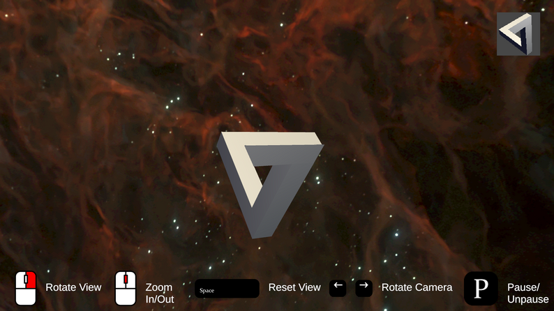
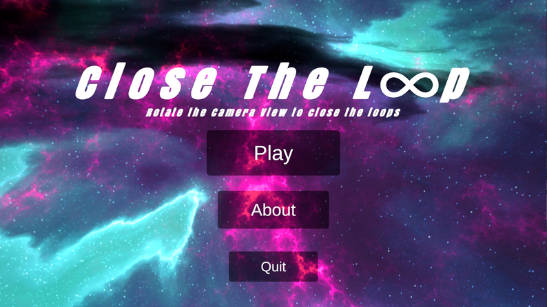
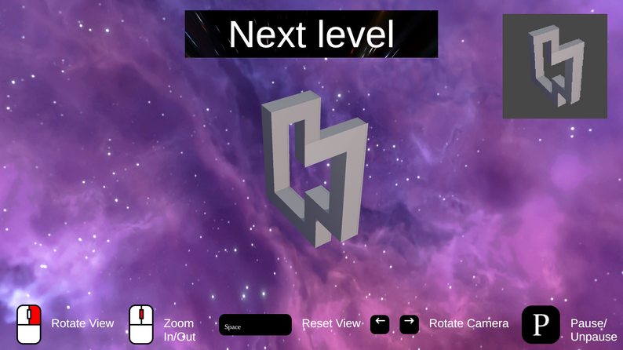
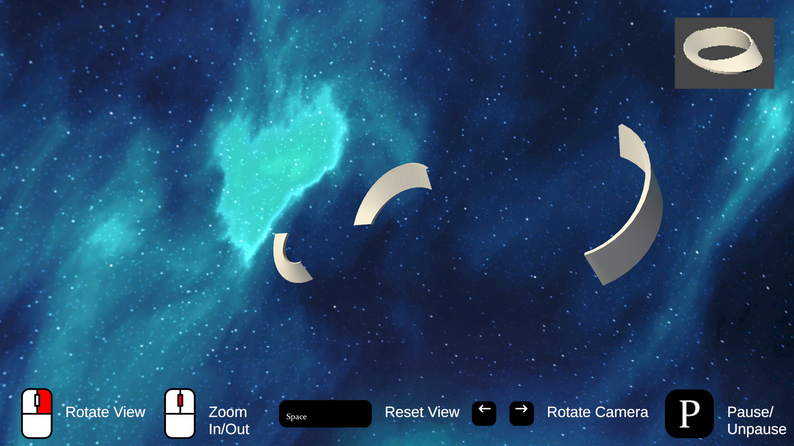

# Close the Loop | GMTK 2025

A chill visual-illusion puzzle game. Rotate the camera, find the right angle, and watch scattered shapes become a continuous loop. No timer and no fail state, just perception and the satisfaction of making everything click.

[Play / download on itch.io](https://kuruttakao.itch.io/close-the-loop)

## How to play

1. Rotate the camera using your mouse.
2. Look for shapes and segments that almost connect.
3. Adjust your perspective until they form a complete loop.
4. Continue when the completion interface appears.

## My work

I developed the game for GMTK 2025 and continued improving it after submission. My work covers the perspective-puzzle experience, camera controls and completion feedback, followed by axis-inversion options, startup pause fixes and web-build preparation.

## How the puzzle works

The puzzle setup spreads shape segments along a direction and adjusts their scale. The player searches for the viewpoint that makes them read as one loop. A solution trigger guides the view toward the aligned position and shows the next-puzzle interface.

The design keeps the interaction small so the visual discovery is the focus. Further tuning could improve alignment tolerance and camera sensitivity across players and devices.

## Explore the code

- [CameraController.cs](Assets/_Managers/_Scripts/CameraController.cs): camera input and axis inversion.
- [PuzzleManager.cs](Assets/_Managers/_Scripts/PuzzleManager.cs): puzzle flow and pause state.
- [GeneratePuzzle.cs](Assets/_Models/_Scripts/GeneratePuzzle.cs): segment placement and scaling.
- [CorrectPosition.cs](Assets/_Models/_Scripts/CorrectPosition.cs): solution detection and completion feedback.

## Open the project

1. Clone the repository.
2. Open the root folder through Unity Hub using **Unity 2022.3.62f2**.
3. Let Unity restore the packages and import assets.
4. Inspect the scenes in Build Settings. Use itch.io above for the playable build.

## Development milestones

- **August 2025:** jam submission, followed by camera and pause-state fixes.
- **November 2025:** web-build preparation and texture-setting updates.

This is a jam project with follow-up updates. This documentation update does not establish a new tested release. Imported art, music and packages retain their respective creators and terms.

## Gallery

